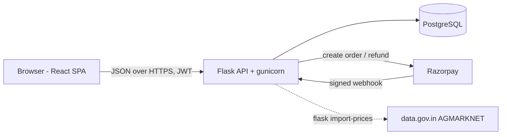
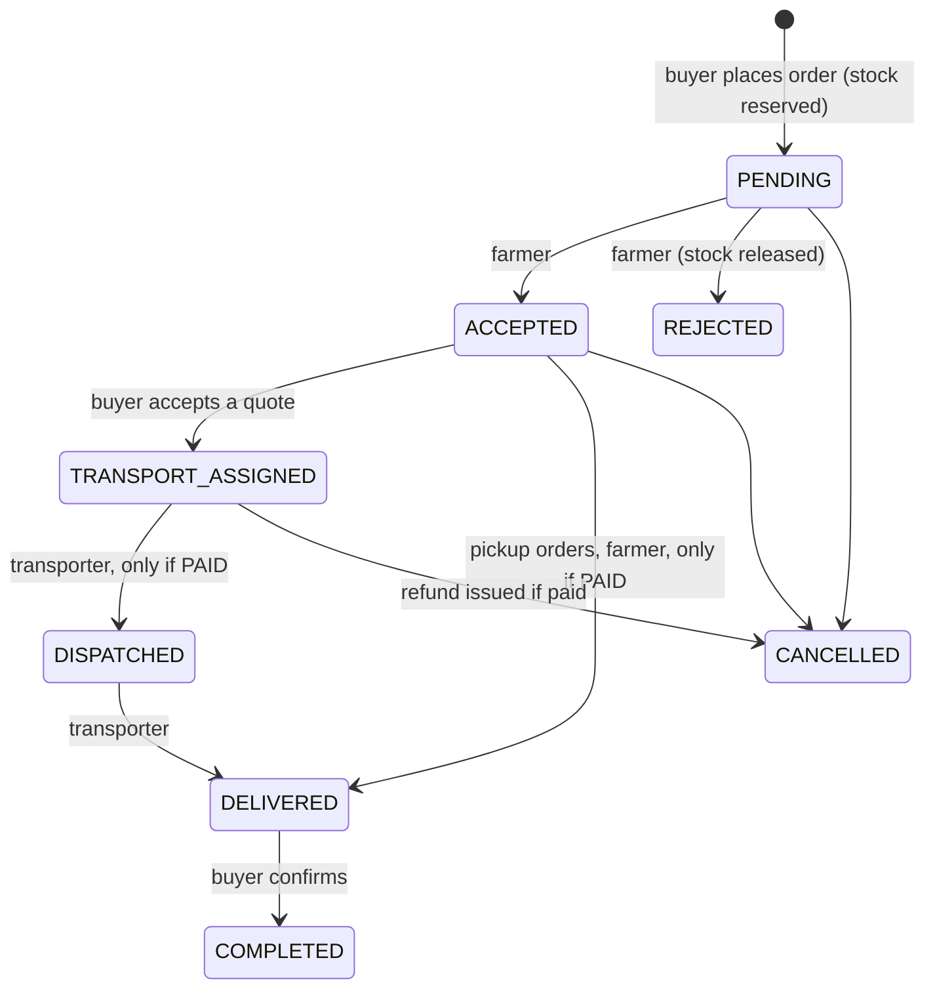
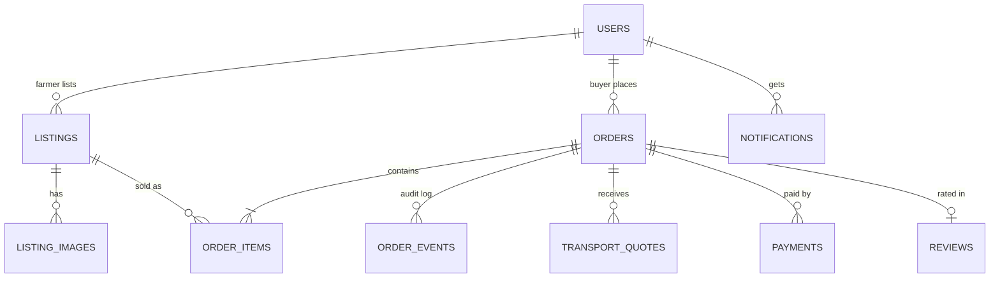

# FarmFresh

A multi-sided agricultural marketplace: farmers list produce, buyers order directly, transporters quote for delivery, and every price is shown next to the day's mandi rate.

**Stack:** Python · Flask · PostgreSQL · SQLAlchemy/Alembic · JWT · Razorpay · React 19 · Tailwind CSS 4 · Recharts · Docker · GitHub Actions · Render

## What it does

| Role | Can do |
|---|---|
| Farmer | List harvests with photos, see the mandi median while pricing, accept/decline orders, track sales and ratings |
| Buyer | Search and filter produce, compare against mandi prices, order from several farms in one basket, choose a transporter, pay, rate |
| Transporter | See loads ranked by vehicle fit and service area, quote, mark pickup and delivery, track earnings |
| Admin | Verify or suspend accounts, hide listings, view platform-wide order value and status |

Demo accounts (password `farmfresh123`): `farmer@farmfresh.demo`, `buyer@farmfresh.demo`, `transport@farmfresh.demo`. The login page has one-click buttons for each. Local runs (`flask seed`, `docker compose`) also create `admin@farmfresh.demo`; a production deploy never does, because the demo password is public. There the admin comes from the `ADMIN_EMAIL` / `ADMIN_PASSWORD` environment variables.

## Architecture



One Docker image serves both the API (`/api/v1/*`) and the built React app, so deployment is a single web service plus a managed Postgres. Product photos are resized in the browser and stored in Postgres, so there is no object-storage dependency.

## Order lifecycle



All transitions go through one function, `transition()` in `backend/app/orders.py`. It locks the order row, checks the move is legal for the current state and the actor's role, applies side effects (stock release, refunds, quote clean-up, notifications) and writes an audit event, all in a single transaction.

## Data model



## Engineering decisions worth asking about

- **No overselling under concurrency.** Order creation locks the listing rows with `SELECT … FOR UPDATE` (always in id order, so two multi-item orders can't deadlock), checks stock and decrements it in the same transaction. `tests/test_concurrency.py` fires 10 simultaneous orders at the last 5 kg; exactly one succeeds. With the lock removed the same test sells 50 kg of a 5 kg listing, so the test genuinely guards the behaviour.
- **Payments are verified server-side.** The amount comes from the order total in the database, never from the client. An order is marked paid only after the Razorpay HMAC signature checks out, or a signed webhook arrives. Both paths are idempotent, so a replayed webhook can't double-record a payment. Cancelling a paid order triggers a Razorpay refund in the same transaction.
- **Idempotent order creation.** The basket sends an `Idempotency-Key` per farmer; a retried request returns the original order instead of creating a duplicate (enforced by a unique constraint, which also covers two retries racing each other).
- **Price history is frozen.** `order_items.agreed_unit_price` copies the price at order time, so editing a listing never rewrites past orders. Money is `NUMERIC(12,2)` everywhere.
- **Data minimisation.** Phone numbers and the delivery address are only revealed to the other party after the farmer accepts.
- **Role-based authorization on every route**, plus ownership checks (a farmer can't edit someone else's listing by changing the id; other users' orders return 404, not 403, so ids can't be probed).
- **Explainable transporter matching.** Jobs are ranked by whether the load fits the vehicle's capacity and whether pickup is in the transporter's service area.
- **Honest price data.** Out of the box the app uses clearly labelled sample mandi data. `flask import-prices` pulls real AGMARKNET reports from data.gov.in when an API key is set, and the UI switches its source label automatically.

## Run locally

With Docker:

```bash
docker compose up --build        # http://localhost:8000, seeded with demo data
```

Without Docker (Python 3.12+, Node 20+, PostgreSQL running):

```bash
cd backend
pip install -r requirements.txt
createdb farmfresh && createdb farmfresh_test
export FLASK_APP=wsgi.py
flask db upgrade && flask seed
flask run                        # API on :5000

cd ../frontend
npm install && npm run dev       # UI on :5173, proxies /api to :5000
```

Tests: `cd backend && pytest -q` (needs the `farmfresh_test` database).

## Deploy (Render, free tier)

1. Push this repo to GitHub.
2. In Render: **New → Blueprint**, pick the repo. `render.yaml` creates the Postgres database and the web service, generates secrets, runs migrations and seeds demo data on first boot.
3. Set `ADMIN_EMAIL` and `ADMIN_PASSWORD` (12+ characters) in the service's **Environment** tab. The admin account is created on the next deploy.
4. Optional: add Razorpay test keys under the service's **Environment** tab, then redeploy. Without keys the app runs a clearly labelled demo checkout.

Note: Render's free Postgres expires after 30 days; point `DATABASE_URL` at Neon or Supabase for a longer-lived free database.

### Razorpay

1. Sign up at dashboard.razorpay.com and stay in **Test mode**.
2. **Account & Settings → API Keys → Generate test key**: set `RAZORPAY_KEY_ID` and `RAZORPAY_KEY_SECRET`.
3. **Webhooks → Add**: URL `https://<your-app>/api/v1/payments/webhook`, events `payment.captured`, `payment.failed`, `refund.processed`, and a secret you copy into `RAZORPAY_WEBHOOK_SECRET`.
4. Test card `4111 1111 1111 1111`, any future expiry, any CVV; or UPI `success@razorpay`.

### Live mandi prices (optional)

Get a free key at data.gov.in, set `DATA_GOV_API_KEY`, then run `flask import-prices --state "Tamil Nadu"` (on Render: the service's Shell tab, or a cron job).

## API overview

All routes are under `/api/v1`. Errors have one shape: `{"error": {"code", "message", "fields?"}}`.

| Area | Routes |
|---|---|
| Auth | `POST auth/register`, `POST auth/login`, `POST auth/refresh`, `GET/PATCH auth/me` |
| Listings | `GET listings` (search, filters, sort, pagination), `GET listings/crops`, `GET listings/:id`, `POST listings`, `PATCH listings/:id`, `GET my/listings`, `GET farmers/:id`, `GET images/:id` |
| Orders | `POST orders` (Idempotency-Key), `GET orders`, `GET orders/:id`, `PATCH orders/:id/status`, `POST orders/:id/review` |
| Transport | `GET transport/jobs`, `GET transport/deliveries`, `POST transport/jobs/:order_id/quotes`, `DELETE transport/quotes/:id`, `POST transport/quotes/:id/accept` |
| Payments | `GET payments/config`, `POST payments/orders/:id`, `POST payments/verify`, `POST payments/failed`, `POST payments/webhook` |
| Prices | `GET prices/commodities`, `GET prices?commodity=&days=`, `GET prices/board` |
| Dashboard | `GET dashboard` (role-specific), `GET notifications`, `POST notifications/read` |
| Admin | `GET admin/users`, `PATCH admin/users/:id`, `GET admin/listings`, `PATCH admin/listings/:id`, `GET admin/orders` |

## Project layout

```
backend/
  app/            auth, listings, orders (state machine), transport, payments, prices, dashboard, cli (seed/import)
  migrations/     Alembic migrations
  tests/          API, lifecycle, payment-signature and concurrency tests
frontend/
  src/pages/      Landing, Market, ListingDetail, Cart, Orders, OrderDetail, MyListings, Dashboard, Prices, Transport, Admin
  src/components/ Shell, rate board, listing cards, price chart, UI kit
Dockerfile        builds the UI, then the API image that serves it
render.yaml       one-click Render deployment
```

## Roadmap

Demand forecasting from the platform's own order history, image-based quality grading, SMS notifications, Tamil-language UI, and government scheme discovery.
